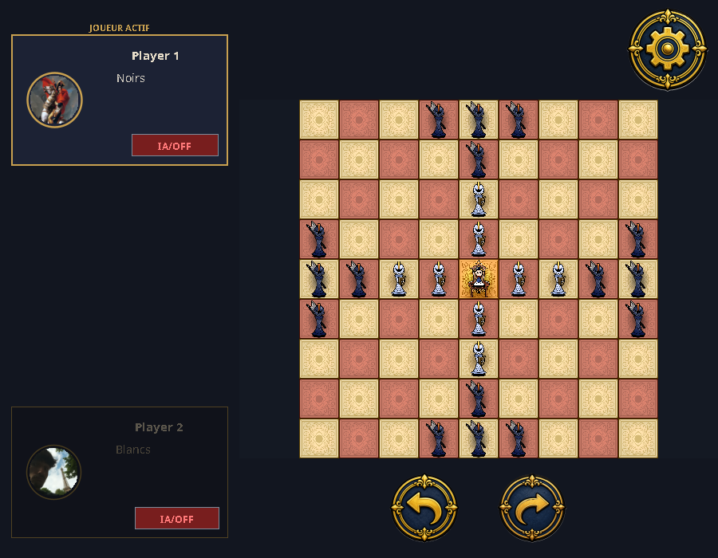

# Tablut — Java strategy game

A desktop implementation of **Tablut**, an asymmetric board game in the Tafl family, with a custom Swing interface, adversarial search AI and two-player TCP multiplayer.

Developed collaboratively for **Programmation 6**, third-year Computer Science (**Licence 3 Informatique**) at **Université Grenoble Alpes**, academic year **2025–2026**. The project brings together object-oriented modelling, user interface design and classical game AI.



## Features

- A 9 × 9 board with movement validation, captures, king escape/capture and victory/draw feedback.
- Local human vs human, human vs AI, and AI vs AI play; each side can independently enable AI and select its level.
- Three selectable AI levels using minimax with alpha-beta pruning, move ordering and heuristic evaluation.
- Background AI calculation with cancellable searches, keeping Swing responsive.
- Legal destination highlighting, player names, active-player indicators, undo/redo and saved games.
- Napoleon-inspired and Star Wars visual themes, plus an illustrated 11-page tutorial.
- TCP multiplayer for two clients, including synchronized moves, negotiated undo/draw and surrender.
- Dependency-free build scripts and automated model, AI, persistence, protocol and desktop checks.

The interface retains its original mix of French and English labels. Multiplayer uses a standalone server or the menu's **Host** option; it does not provide matchmaking or a hosted online service.

## Rules implemented

Tablut has several historical and modern variants. This repository implements the following variant:

1. **Black attackers** start with 16 pieces and move first. **White defenders** have eight soldiers and a king on the central throne.
2. Pieces move any number of empty squares horizontally or vertically, without jumping over another piece.
3. After the king leaves the throne, no piece can enter or cross it. The empty throne can act as a hostile square during captures.
4. Ordinary pieces are captured when an opponent's move sandwiches them between enemy pieces, or between an enemy piece and the empty throne. The king can assist white captures.
5. White wins when the king reaches **any board edge**, or when no black pieces remain.
6. Black wins by capturing the king. In the **central 3 × 3 area**, all four adjacent squares must be black pieces or the empty throne; elsewhere, an ordinary two-sided black sandwich captures the king.
7. A player with no legal moves loses. Local play declares a draw when the same **board arrangement** appears three times. Repetition currently compares boards rather than board-plus-player states.

The central 3 × 3 capture rule, throne restrictions and board-only repetition are preserved from the university implementation. They are not presented as universal Tafl rules.

## Getting started

### Requirements

- **JDK 21 or later** (`java`, `javac`, `jar`). A JRE alone cannot compile the sources.
- Bash and standard Unix tools for the supplied scripts (Linux, macOS, or Windows through WSL).
- A graphical desktop for interactive play. On a headless Linux machine, Xvfb can run the desktop tests.

There are no third-party Java libraries, package downloads, API keys or databases required by the application.

From the repository root:

```bash
bash scripts/build.sh
java -jar build/Tablut.jar
```

Alternatively, rebuild and launch with:

```bash
bash scripts/run.sh
```

If the JDK is not on `PATH`, set `JAVA_HOME` to its installation directory; the scripts use it automatically. Builds target Java 21 with UTF-8 encoding. Application images and tutorials are included in the generated JAR, so it also launches from another working directory:

```bash
java -jar /absolute/path/to/Tablut/build/Tablut.jar
```

Saves are writable files under `res/saves/`, relative to the launch directory. Ten original saved positions remain in the checkout as examples. To use another save directory:

```bash
java -Dtablut.saves.dir=/absolute/path/to/my-saves -jar build/Tablut.jar
```

Local save filenames must not contain directory separators. New local saves and build products are ignored by Git; the original tracked examples remain versioned.

### Example workflows

**Local game:** choose **Nouvelle Partie**, enter the two player names, select a piece and click a highlighted destination. Use the arrows below the board to undo/redo.

**Play against AI:** enable **IA/ON** on the desired player's card. Its slider chooses **Facile**, **Moyen** or **Difficile**. Enable AI for both sides to watch a game. The original two-second pacing before a computer turn is retained.

**Change theme or learn the rules:** use **Options → Changer thème** or **Show Tutorial**. The in-game settings menu also opens the tutorial.

**Multiplayer:** start a server in a separate terminal:

```bash
java -cp build/Tablut.jar tablut.network.ServerTablut
```

Then launch two game instances, choose **Online → join**, and enter the server's hostname (use `localhost` on the same machine). Alternatively, one game instance can select **Online → Host** and the other can join it. The server handles one two-player session on TCP port **2121** and exits at the end of the session or after a connected client disconnects. Restart it for another session.

## Architecture

```text
Tablut/
├── src/main/java/tablut/
│   ├── Tablut.java          # Swing application entry point
│   ├── model/               # Board, rules, history and saved-game state
│   ├── ai/                  # Strategy API, alpha-beta search and evaluation
│   ├── controller/          # Local/network interaction and AI orchestration
│   ├── ui/                  # Swing windows, board rendering and tutorial
│   ├── network/             # TCP client and two-player server
│   │   └── protocol/        # Requests, responses and board/move serialization
│   └── config/              # Theme paths, board size and save directory
├── src/main/resources/res/  # Both themes, tutorial images and preserved extra artwork
├── src/test/java/tablut/    # Standalone automated test programs
├── scripts/                # Build, test and launch entry points
├── res/saves/               # Ten original university save examples
├── res/tests/               # Compatibility test entry point and original placeholder
├── docs/
│   ├── reports/             # Original university PDFs, unchanged
│   ├── screenshots/         # Captures of the running Swing interface
│   ├── AUDIT.md             # Full source/document audit and refactoring rationale
│   └── VALIDATION.md        # Executed checks and known limitations
├── dist/legacy/Tablut.jar    # Original university artifact, preserved unchanged
└── .github/workflows/ci.yml # Build and test automation
```

`BaseJeu` implements board rules and conversion to/from six 64-bit fields. `Jeu` adds turn progression, undo/redo, repetition and file persistence. AI strategies depend on the model, while the model does not depend on Swing, networking or AI. The local controller runs search on a copied game through `SwingWorker` and applies its result on Swing's event dispatch thread. The network server owns the authoritative game state; the client dispatches received updates to Swing.

The refactoring retains the original French domain class names to limit churn. Legacy AI experiments are preserved separately from the three strategies exposed by `IA.creer`. See [the audit](docs/AUDIT.md) for every class's role and the remaining design tradeoffs.

## Artificial intelligence

All three selectable levels use **minimax with alpha-beta pruning**. Black maximizes the evaluation and white minimizes it. Search copies the board for each child, orders moves using estimated captures/king movement/proximity, checks immediate wins and randomly chooses between equally scored moves.

| Level | Implementation | Recursive depth after candidate move | Maximum plies including candidate | Evaluation used |
| --- | --- | ---: | ---: | --- |
| Easy | `EasyAI` (formerly `IAeasy`) | 1 | 2 | King routes, adjacent defenders, black Manhattan-distance pressure; stochastic recognition of an escaped king in evaluated positions |
| Intermediate | `IntermediateAI` (formerly `IAinter`) | 1 | 2 | Easy's positional criteria plus material balance and deterministic king escape/capture evaluation |
| Hard | `HardAI` (formerly `IAhardV2`) | 3 | 4 | Material, threatened pieces, king distance to edge, route/fork/pre-fork bonuses, nearby attackers, adjacent protection and Manhattan pressure |

The hard heuristic includes material weight 500, threat weight 35, edge-distance weight 40, route bonus up to 700, fork bonus 4,000, pre-fork bonus 1,500, king-threat scores 80/350/8,000, protection weight 15 and pressure weight 15. Its fork estimate can count routes blocked by black pieces; it is an evaluation approximation, not a guaranteed tactical win.

The search depths, weights, tie-breaking and easy level's stochastic escape evaluation have been preserved. The missing-king null dereference was fixed. There is **no machine learning or neural network** in this project. No transposition table, iterative deepening or MCTS is implemented. The existing tests check correctness and progression; they do not establish a measured playing-strength hierarchy.

The [original AI report](docs/reports/Dossier%20IA.pdf) describes the academic design and historical evaluation. Some statements differ from the current code, especially easy/intermediate depth and heuristics. The [audit](docs/AUDIT.md) records those differences without editing the report.

## Tests

```bash
bash scripts/test.sh
```

This builds the application JAR, compiles tests separately and runs **11 test programs** against the packaged application: model, bitboards, serialization, two-client networking, three AI levels, rules/history, persistence, AI regressions and all 82 original image resources. Any failure stops the script and returns a nonzero exit code. The network test temporarily uses port 2121; keep it free.

Desktop integration is optional for the headless model workflow:

```bash
# With a desktop display:
bash scripts/test.sh --gui

# On headless Linux with Xvfb installed:
xvfb-run -a -s '-screen 0 1280x1024x24' bash scripts/test.sh --gui
```

`TestGui` checks both themes, nickname input, new-game windows, all 11 tutorial pages, Swing responsiveness during hard AI calculation and cancellation on disposal. The GitHub Actions workflow runs the automated and desktop checks. See [validation results](docs/VALIDATION.md) for checks performed locally; the hosted workflow has not run until changes are pushed.

## University reports and preserved artifact

- [AI validation report — Groupe 5](docs/reports/Dossier%20IA.pdf)
- [Human–computer interaction report — Groupe 5](docs/reports/Rapport_IHM.pdf)

The PDFs are kept byte-for-byte unchanged. The original `Tablut.jar` is archived under `dist/legacy/`; it uses **Java 25 bytecode** and is retained as a historical deliverable. Use the source-built `build/Tablut.jar` for development and the refactored application.

## Technical skills demonstrated

- Object-oriented board-state modelling and separation of model, presentation, search and transport.
- Adversarial search, alpha-beta pruning, heuristic evaluation and compact board serialization.
- Swing/AWT event handling, custom painting, resource packaging and background task lifecycle.
- TCP sockets, message framing, shared-state coordination and multiplayer synchronization.
- File persistence, regression testing, reproducible builds and version-control hygiene.

This is a collaborative university project, with the reports preserved as academic context. [The audit](docs/AUDIT.md) and [validation notes](docs/VALIDATION.md) make its capabilities and remaining limitations explicit.
